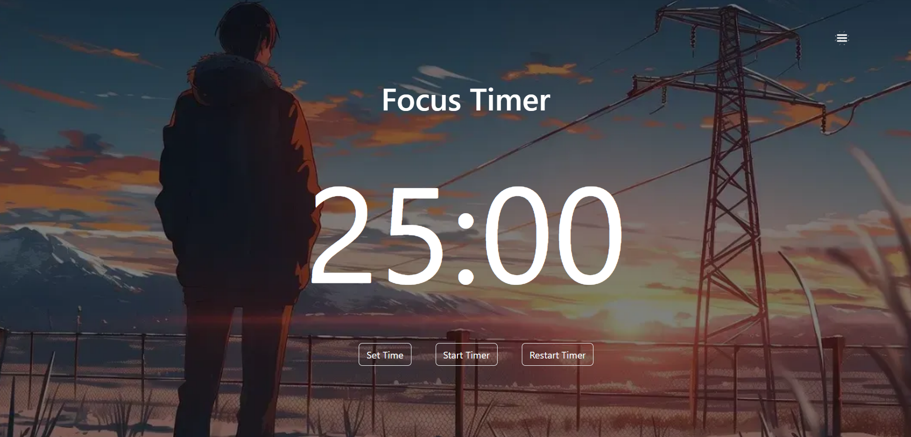
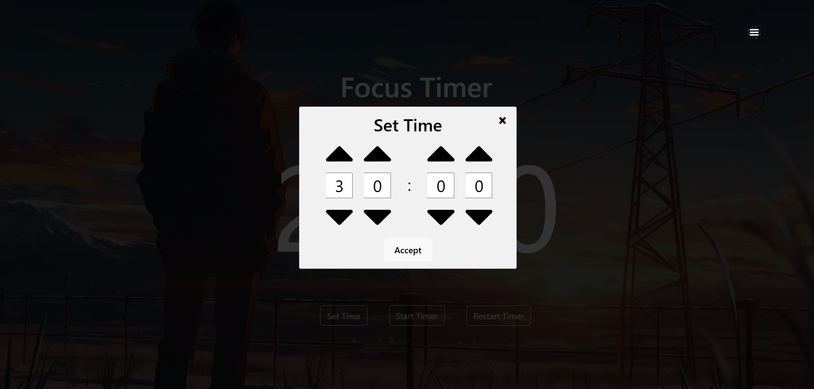
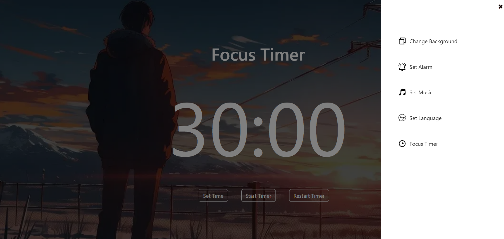
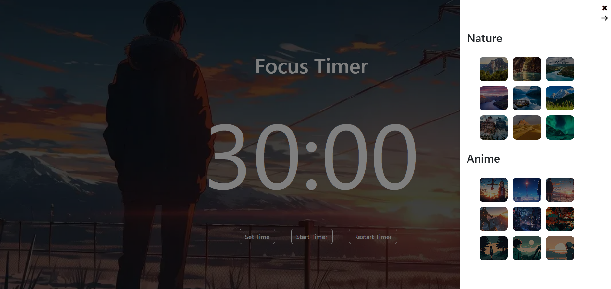
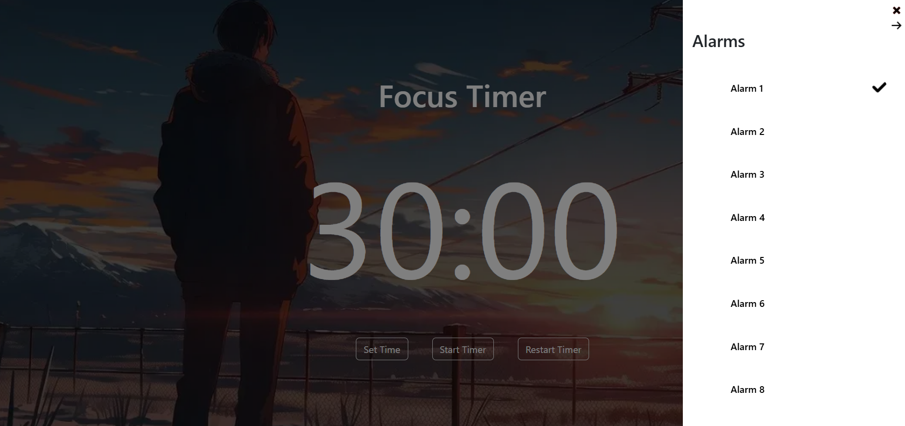
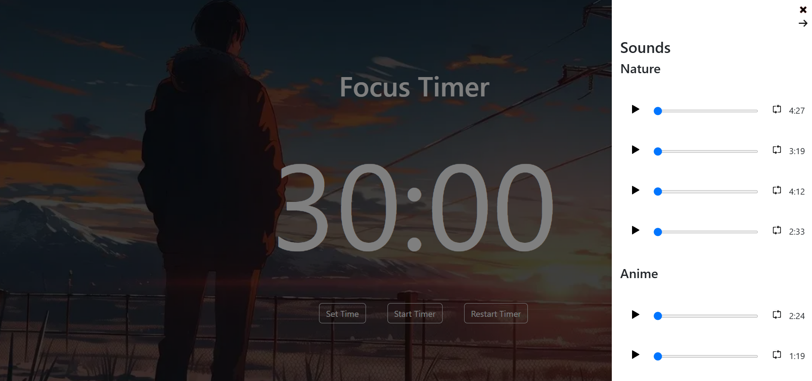
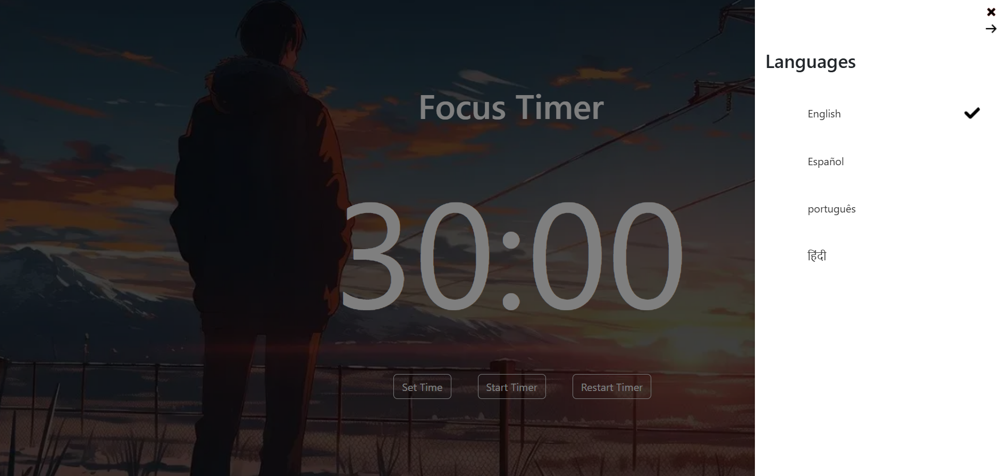
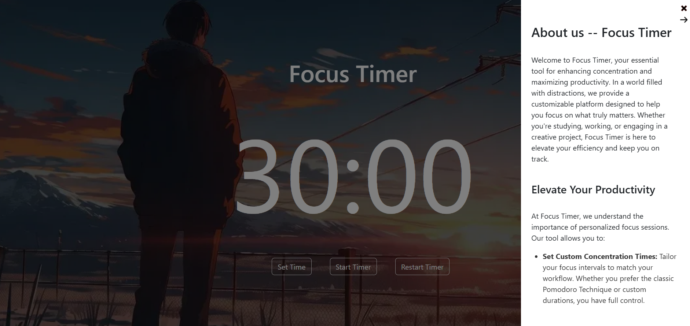

# Focus Timer 🚀

[🚀 Try Focus Timer](https://www.focustimeritisfocustime.com/)

Focus Timer counts down for a duration set by the user and plays an alarm when the timer reaches zero.

Users can customize:

- The timer duration.
- The background image.
- The background sounds.
- The alarm sound.
- The interface language.

## 💡 Product Design Goals

- **Mix and match ambient settings:** Users can combine background images and sounds within the same category, such as pairing different cafe images with cafe ambience.
- **Accessible, localized image descriptions:** Background images include descriptions for screen-reader users, provided in the user's selected language.
- **An India-inspired experience:** India-themed backgrounds and ambient sounds, together with Hindi language support, make the experience more relevant to users interested in this cultural theme.

## 🏗️ Architecture

The project separates presentation from behavior and state management. Focused hooks handle component logic, Redux Toolkit manages shared application state, and UI components render the data they receive. This structure helps keep responsibilities clear and components easier to maintain and test.

## 🛠️ Technologies Used

- HTML5 and CSS3
- TypeScript
- React and Redux Toolkit
- Bootstrap
- Vite
- Jest and Testing Library
- ESLint

## 📦 Installation

### Prerequisites

- Node.js and npm

To clone and configure this application locally, run the following commands:

```bash
# Clone the repository
git clone https://github.com/2020LM/react-repasoUpdate.git

# Navigate into the project directory
cd react-repasoUpdate

# Install dependencies
npm install
```

## 🚀 Running Locally

You can run the project in the following environments:

### Development Mode
Ideal for making code changes with automatic reload:
```bash
npm run dev
```

### Preview a Production Build
Build the optimized application, then run Vite's local preview server to verify the production build. This previews the build locally; it does not deploy the application.
```bash
# Build the project
npm run build

# Preview the production build locally
npm run preview
```

## ✨ Main Features

Discover what the project does and see it in action:

### 📊 Main Dashboard
The central hub of the application. Users can seamlessly access and navigate through all primary features and options on the website.



### ⏱️ Custom Timer Setup
Users can easily adjust and set the timer countdown duration by clicking the "Set Time" button.



### 📂 Navigation Sidebar
A collapsible sidebar menu providing quick access to additional system controls and user preferences.



### 🖼️ Dynamic Backgrounds
Users can personalize their experience by selecting their preferred visual background for the timer.



### 🔔 Custom Alarm Sounds
Users can configure and select the specific alert sound they want to hear when the countdown finishes.



### 🎵 Ambient Background Sounds
Users can choose ambient audio to listen to while the timer runs.



### 🌐 Multi-Language Support
Users can switch and select their preferred language across the entire website interface.



### 📝 About Focus Timer
A dedicated section describing the purpose and features of the application.




## 🧪 Testing

This project uses Jest and Testing Library for automated tests. Run the test suite with:

```bash
# Run the complete test suite
npm test

# Check the code with ESLint
npm run lint
```

## 🔮 Future Improvements

Evaluate approaches to improve initial loading and SEO: prerender low-dynamic sections while keeping the interactive timer as an SPA, or migrate to an SSR architecture with Next.js. Compare the effects on initial JavaScript bundle size, rendering, SEO, and implementation complexity before choosing an approach.

## ✒️ Author

- [Gabriel Oviedo](https://github.com/2020LM)